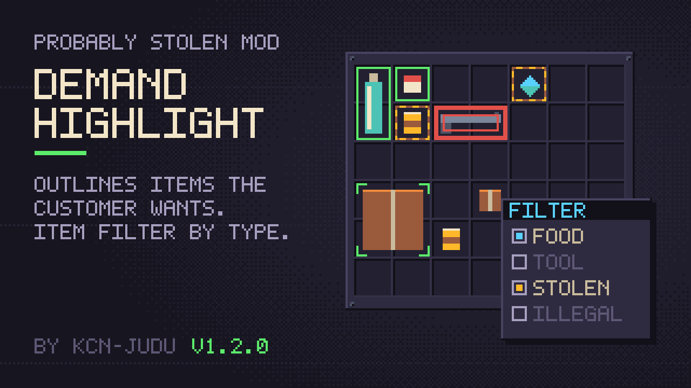

# Demand Highlight



A mod for *Probably Stolen*. Outlines what the customer at the counter wants, with a different look for wanted, stolen, contraband and "something wanted is inside", and adds an Item Filter window that marks your stock by type or by a typed expression. Other mods can run the same queries through a small [query API](doc/manual/query-api.md).

**Documentation:** <https://kcn-judu.github.io/ProbablyStolen-Mods/en/demand-highlight/> ([简体中文](https://kcn-judu.github.io/ProbablyStolen-Mods/zh-cn/demand-highlight/))

Part of the [Probably Stolen mods collection](https://github.com/KCN-judu/ProbablyStolen-Mods).

## Install

Subscribe on the [Steam Workshop](https://steamcommunity.com/sharedfiles/filedetails/?id=3832481488), or copy the folder from a [release](https://github.com/KCN-judu/ProbablyStolen-DemandHighlight/releases) into the game's `Mods` folder. Then enable the mod in the game's Mods menu and restart the game.

## Build

```bash
./build.sh            # out/demand_highlight
./build.sh --install  # also copies it to the game's Mods folder
```

See [Building](doc/manual/building.md) for the requirements and the `GAME` and `CSC` variables.

## Repository layout

| Path | Contents |
| --- | --- |
| `src/` | The mod's source; files ending in `.Pure.cs` need neither Unity nor the game |
| `api/` | `DemandHighlightQuery.cs`, the file another mod copies in to use the query API |
| `tests/` | Headless tests (`tests/run.sh`) |
| `tools/QuerySample/` | A development mod that uses the query API, not part of the release |
| `doc/manual/` | Documentation, in English (the source of every translation) |
| `doc/locale/` | Translations of the documentation, as gettext catalogs |
| `manifest.xml`, `preview.png` | What the game reads, next to the DLL |
| `WORKSHOP.txt` | The Steam Workshop description, in BBCode |
| `CHANGELOG.md` | Changes by version |

## License

[Apache License 2.0](LICENSE).
