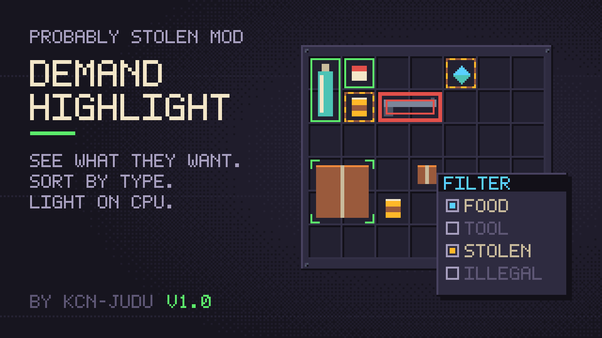
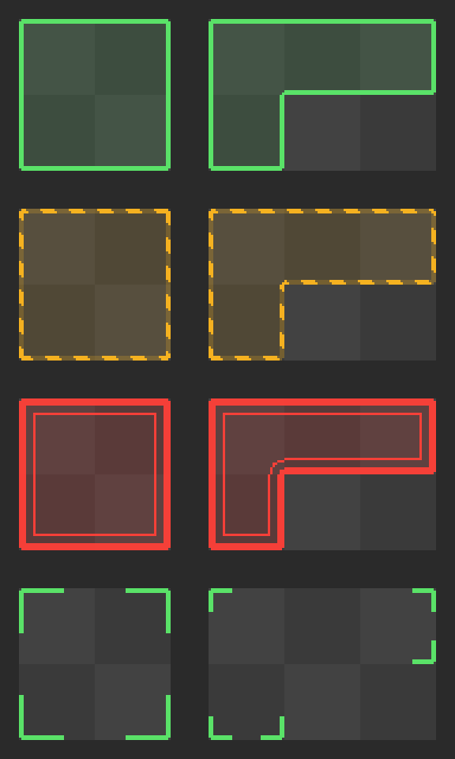

# Demand Highlight

See at a glance what the customer at the counter wants, in the shop inventories, in open containers and on machine storage tabs.

## Outlines

| Look | Meaning |
| --- | --- |
| Green line with a faint fill | Wanted |
| Amber diagonal "caution tape" | Wanted, and stolen |
| Red heavy line with a thin inner line | Wanted, and contraband |
| Corner brackets in one of those colours | Not wanted itself, but something wanted is inside |

Outlines follow each item's grid cells, so an L-shaped item gets an L-shaped outline. Patterns as well as colours tell the styles apart.

## Rules

- Locked containers, items behind a lock and immovable items are skipped, as the customer would see them.
- During an inspection, only stolen goods and contraband are marked, and containers that block a search are skipped.
- When a customer is selling, their own stolen goods and contraband are marked only if the option is on. It is off by default.

## Options

| Option | Default | What it does |
| --- | --- | --- |
| Outline thickness | 2 | Line width in UI pixels, from 1 to 6. |
| Corner rounding | 2 | Radius of the rounded outer corners, from 0 to 8. |
| Tint wanted items | on | A faint fill inside the outline of wanted items. |
| Mark the customer's own goods | off | When a customer is selling, mark their stolen goods and contraband. |
| Toggle demand highlight | unbound | A key that turns the outlines on and off, the Item Filter's marks included. |
| Open item filter | unbound | A key that opens the [Item Filter](item-filter.md) window. |

Neither key has a default. Bind them in the game's options menu.

If you use another demand-highlight mod, turn it off, or both will draw outlines.
