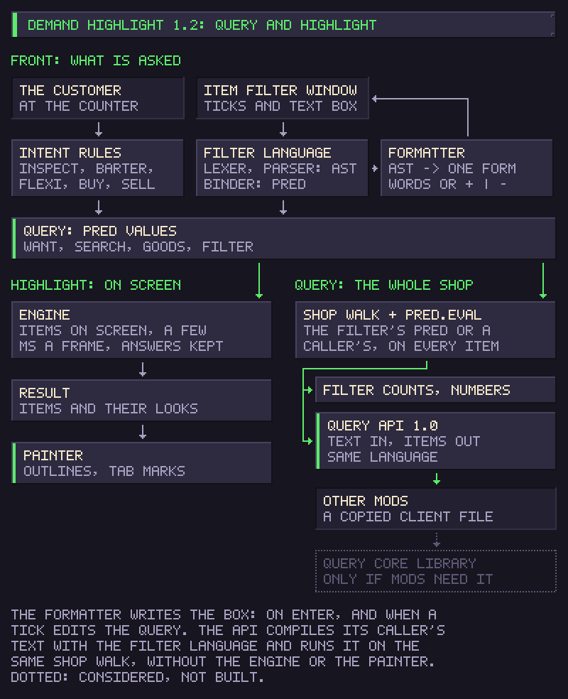

# Performance

Demand Highlight does very little work per frame, even in a store with thousands of items.

## Work only on change

The mod is three parts that only hand data to each other. The first reads what the customer at the counter wants, or what the Item Filter asks for, and writes it down as a query: a small value such as "items the game says this customer buys, except these identifiers". The second answers the query over the store. The third draws the answer. The second part never looks at the customer and the third never looks at the query. The Item Filter's counts and the [Query API](query-api.md) use a fourth part, a plain walk over the whole shop that evaluates a query on every item and keeps nothing; it does not touch the second or third.

While nothing changes, the mod does not walk the shop. A walk starts when the query changes, an item is validated, turned or has a tag changed, an item enters or leaves an inventory, or a container window opens or closes. Tooltips and other windows are ignored. Changes are batched into at most one walk every 0.15 s. The only repeated work is reading the query every 0.5 s, because the game gives no signal when a customer changes what they want, and comparing it with the last one.

## One question per item

The game's own "would this customer buy it" check, run on a container, lists every item inside and checks each one again, recursively, which is quadratic in a deep store. The mod asks the game only about the item itself and rebuilds the same rule bottom-up: a container is bought when it is acceptable itself and, unless it is locked, has no window or is an advanced gun, everything inside it is bought. Each item is checked once per customer.

## A record per item

Each item keeps three things, each for exactly as long as it holds:

- its facts (stolen, contraband, locked, yours): until the item changes;
- the game's answer to "would this customer buy it": until the item changes or the question does. The question names everything the answer depends on, the customer and what they want, so a new customer asks again and the same customer does not;
- its verdict on the query and, for a container, a summary of what is inside: until the query or the item changes.

A change to an item clears its record and marks only the summaries of the containers above it as stale. When you sell to a customer who wants variety, only the query changes ("except this identifier"), so every item is judged again from what it already knows, without asking the game again.

The Item Filter window counts the whole shop by type and adds up its numbers in one walk, only while it is open, and only when the stock or the filter changed, at most every 0.5 s.

## Only what is on screen

A walk visits the shop inventories and open containers. Closed containers answer from their record.

## Big jobs over several frames

A walk stops after 2.5 ms and continues on the next frame, so a new customer in a huge store does not cause one long frame. Outlines appear over a few frames instead.

## Cheap drawing

Rectangular items share one small nine-slice frame per look, so an outline of any size reuses the same texture. Other shapes get a texture drawn for their exact cells, cached by shape and size. An outline is redrawn only when its look, shape or size changed. Outlines that are not needed any more are hidden and kept for reuse; to find them, only the outlines shown last time are looked at, not every one kept.

## Nothing kept after leaving the store

A store's items, their UI, windows and customers all point at each other, so a single reference kept after leaving the store would keep the whole store in memory. When another scene replaces the store (`SceneManager.sceneLoaded` in single mode for any scene other than `InventoryScene`, such as the main menu), the mod drops its item records, outlines, last customer and Item Filter window. The next store builds them again. The filter's choices are kept.

## Logging

Any refresh over 8 ms is written to the game's `Player.log` as `[DemandHighlight] slow refresh: ...`, with the time spent walking and drawing, so you can tell whether a stutter comes from this mod. Each new query is written once, as `[DemandHighlight] query: ...`, with how many items were visited, judged, asked about and marked.

## Tested logic

The decisions need neither Unity nor the game, so they live apart from the code that reads the game, in files ending in `.Pure.cs`. `Query.Pure.cs` defines queries and how an item answers them. `Intent.Pure.cs` turns a customer, or the Item Filter, into a query. The filter language is built like a small compiler, one stage per file: `Lexer.Pure.cs` turns text into tokens, `Parser.Pure.cs` tokens into a syntax tree (`Ast.Pure.cs`), `Binder.Pure.cs` the tree into a predicate; `Formatter.Pure.cs` writes a tree in the one canonical form, and `Lift.Pure.cs` turns a predicate back into a tree for it, so typed text and text made by the ticks are formatted alike; `Expr.Pure.cs` runs the stages. `Facets.Pure.cs` reads the window's ticks from a filter and edits it. `QueryApi.Pure.cs` is the public query API's contract and its host side (see [Query API](query-api.md)). `Stats.Pure.cs` adds up the Item Filter's numbers and fills in their line. `Cross.Pure.cs` draws the filter's "exclude" cross from the pixels of the game's check mark: its outline, fill, stroke and size. `Decide.Pure.cs` chooses each item's outline and what it passes on to the containers above it. `Outline.Pure.cs` computes the outline image of each look, for any cell shape. `Style.Pure.cs` combines marks. `StoreExit.Pure.cs` decides which scene loads leave the store.

Eleven tests run these files outside the game, with only the C# compiler. `tests/QueryTest.cs` covers queries and their answers. `tests/IntentTest.cs` covers every kind of customer and the Item Filter. `tests/LanguageTest.cs` is the filter language's specification as tests: tables for the lexer, the grammar, errors, binding and formatting, then properties checked on 2,000 random trees. `tests/ExprTest.cs` covers the filter language, stage by stage. `tests/FacetsTest.cs` covers ticks read from and written into a filter. `tests/StatsTest.cs` covers the numbers and their line. `tests/CrossTest.cs` covers the cross drawn from a check, and prints both. `tests/QueryApiTest.cs` runs the query API end to end: the client file other mods copy in, talking through real AppDomain slots to the host side, with stand-in items. `tests/DecideTest.cs` covers buying, bartering, selling, inspections, locks, blocked searches and the Item Filter. `tests/OutlineTest.cs` covers shapes, corners, rounding and the four looks. `tests/StoreExitTest.cs` covers leaving the store. Each prints ok or FAIL per case and exits with 1 if anything failed. `tests/run.sh` compiles and runs them all.

Starting is all or nothing: if a method the mod hooks is missing, for example after a game update, everything already set up is taken down again, one line is written to `Player.log` and the mod stays off.
