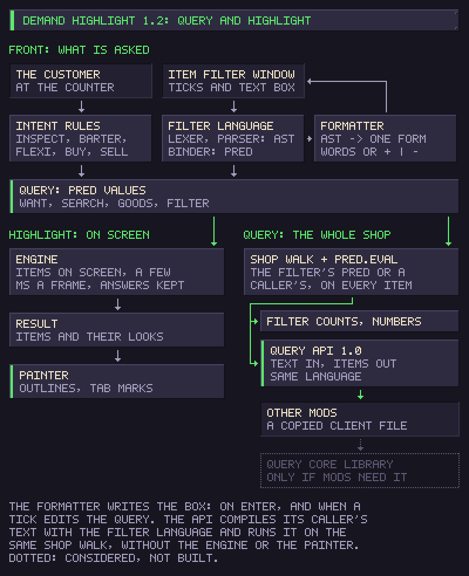

# Query API

Demand Highlight can answer one question for other mods: which items of the shop match an Item Filter expression. You write the expression, for example `type:(food or medical) not stolen`, and get back the matching items, without the outlines, the filter window or anything else of this mod showing up.

You might use it to count what the player has of a kind, to find the stolen goods before an inspection, to sort or move items in your own mod, or to build a feature on the same language the Item Filter uses.



The diagram shows where the API sits. Demand Highlight builds a query from the customer or from the filter window. The highlight (Engine, Result, Painter) is one consumer of that query. The whole-shop walk is another: it serves the filter's counts and this API. The API compiles your text with the filter language and runs it on that walk. It never touches the Engine or the Painter.

## Requirements

- Demand Highlight 1.2.0 or later, enabled. List it as a dependency on your Workshop page if your mod needs it; your mod still loads and runs without it.
- One file in your mod: `api/DemandHighlightQuery.cs` from Demand Highlight's repository. Copy it into your sources. It needs no reference to Demand Highlight's assembly, which you could not use anyway: the game resolves a mod's references inside that mod's own folder only.
- The game's assemblies, which your mod already references (`Assembly-CSharp` for `GameItem`).

## Integration

The client file reads what Demand Highlight publishes when it is enabled. You can check before you call:

```csharp
if (DemandHighlightQuery.Available)
    Debug.Log("[MyMod] Demand Highlight query API " + DemandHighlightQuery.Version);
```

You don't have to check. Without Demand Highlight, every call returns `Status.NotInstalled` and does nothing else, so you can call whenever you like and handle that status.

Load order does not matter. Demand Highlight publishes the API when it is enabled and takes it back when it is disabled, and the client file looks it up again on every call.

## A basic query

```csharp
using System.Collections.Generic;
using UnityEngine;

static readonly List<GameItem> found = new List<GameItem>();

static void CountFood()
{
    var r = DemandHighlightQuery.Run("type:(FOOD or MEDICAL) -stolen", found);
    if (r.Ok)
        Debug.Log("[MyMod] " + r.Count + " items, read as " + r.Text);
    else if (r.Status == DemandHighlightQuery.Status.Invalid)
        Debug.Log("[MyMod] the query has a mistake at " + r.Position + ": " + r.Message);
    else
        Debug.Log("[MyMod] no answer: " + r.Status + " " + r.Message);
    // ... use `found` here ...
    found.Clear();   // let the items go when you are done
}
```

`Run` clears your list, then adds every matching item. Pass `null` instead of a list if you only need `r.Count`.

`tools/QuerySample` in the repository is a small development mod that does exactly this each time a shop loads and writes the answers to `Player.log`. Build it with `tools/QuerySample/build.sh --install`.

## What is searched

Every item of the shop, each once: the shop inventories, the counter, the showcase, the market stall, the hidden and sold areas, and everything inside them, closed and locked containers included. An item matches on its own facts. A container matches only if the container itself matches, not because of what it holds. Items come back in the order of the walk, which is stable for an unchanged shop, but don't rely on it for anything else.

The expression is the Item Filter's language, described in full on [Filter language](filter-language.md): `stolen`, `contraband`, `owned`, `type:`, `tag:`, `id:`, `condition:`, groups such as `type:(a or b)`, and `and` / `+`, `or` / `|`, `not` / `-` with brackets. Type names are read in the player's language too (`type:食物`), so in code use the game's identifiers (`type:FOOD`): they work in every language.

## Building expressions

There is no structured query object in this version. Expressions are text, and two helpers build terms safely:

```csharp
DemandHighlightQuery.Field("id", "two words")    // id:"two words"
DemandHighlightQuery.Quote("or")                  // "or" (inside a group a bare or would be an operator)
string q = "stolen and " + DemandHighlightQuery.Field("type", typeId);
```

`Format` gives an expression back in its canonical form, the one the Item Filter writes, with `and`/`or`/`not` in words or as `+ | -`:

```csharp
var f = DemandHighlightQuery.Format("-stolen + type:(food | medical)", false);
// f.Text == "not stolen and type:(food or medical)"
```

## Results and errors

Every call returns a `DemandHighlightQuery.Result`:

| Field | Meaning |
| --- | --- |
| `Status` | what happened, below |
| `Ok` | `Status == Ok` |
| `Count` | how many items matched (`Run`) |
| `Text` | the expression in canonical form, when it compiled |
| `Problem` | for `Invalid`: `ExpectedTerm`, `ExpectedClose`, `ExpectedValue`, `UnknownKey`, `UnknownWord`, `Unexpected` or `UnclosedQuote` |
| `Detail` | for `Invalid`: the word or character concerned |
| `Position`, `Length` | for `Invalid`: where in your text, 0-based, and how many characters |
| `Message` | what went wrong, in English, for your log |

| Status | When |
| --- | --- |
| `Ok` | the query ran; zero matches is still `Ok` |
| `Invalid` | the expression does not compile: a syntax mistake, an unknown key, an unknown word |
| `NotReady` | no shop is loaded (main menu, loading screen) |
| `Failed` | the expression compiled, but reading the shop failed in the game; `Message` has the exception |
| `BadArgument` | the expression is null or blank |
| `WrongThread` | not called from the game's main thread |
| `NotInstalled` | Demand Highlight is not enabled, or offers no 1.x contract |

`Invalid` is about your text and is reported even with no shop loaded, so you can check an expression in the main menu. `Failed` is about the game at that moment. On anything but `Ok`, your list is left empty.

## Lifecycle and rules

- Call from the game's main thread, as with any game code.
- The items belong to the shop. Use them while it is loaded and let them go when the scene changes. Keeping one keeps the whole store in memory after the player leaves it.
- Nothing is cached between calls: each `Run` walks the whole shop once. Run a query when you need an answer, not every frame.
- Results are a snapshot. If items move afterwards, run the query again.

## Versions

The API has its own version, separate from the mod's. This is contract 1.0, published with Demand Highlight 1.2.0.

- A 1.x release can only add things: new fields at the end of a result, new keys or words in the language. A client file written for 1.0 keeps working with any 1.x.
- A change that would break a 1.x client gets a new major version under new names. An old client then sees `NotInstalled`, never wrong answers.
- `DemandHighlightQuery.Version` tells you which 1.x you are talking to.

How it works underneath: Demand Highlight puts two delegates and a version string into slots of the AppDomain, which every mod's assembly shares, and the client file reads them. You don't need any of this unless you write your own client:

| Slot | Type |
| --- | --- |
| `demand_highlight.query.version` | `string`, `"1.0"` |
| `demand_highlight.query.v1.run` | `Func<string, List<GameItem>, object[]>` |
| `demand_highlight.query.v1.format` | `Func<string, bool, object[]>` |

A result row is `object[] { int status, int count, string problem, string detail, int position, int length, string message, string text }`.

## Not in this version

- Structured queries without text. The predicate types inside the mod are not a contract we want to freeze yet. Text plus `Field` and `Quote` covers what they would do.
- Subscriptions or change notifications. Run the query again when you need a fresh answer.
- Your own keys or predicates in the language.

## What comes next

For now the API lives inside Demand Highlight. If other mods start using it and need more than this, the query part may later move into a small library of its own. That depends on what people actually build with it, so tell us what you need.
